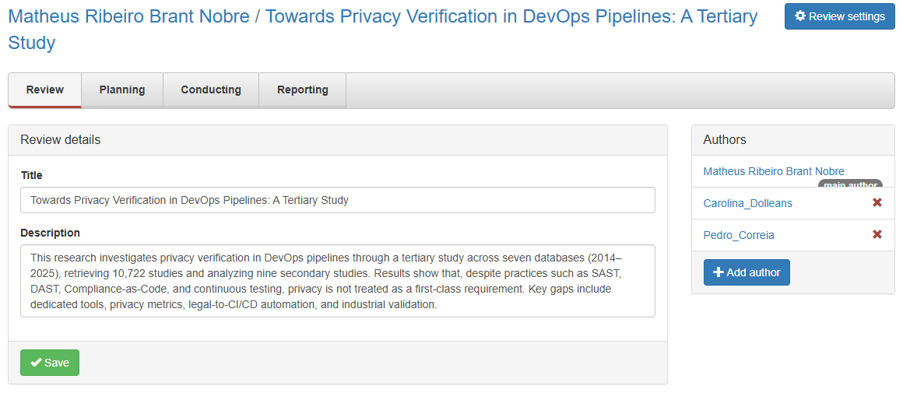
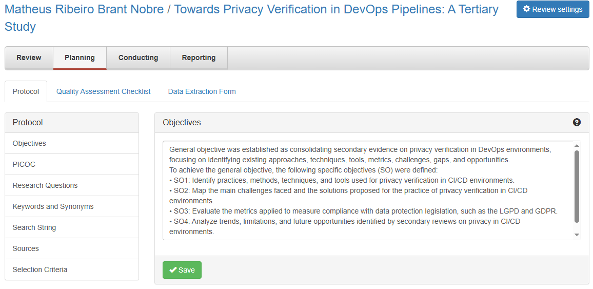
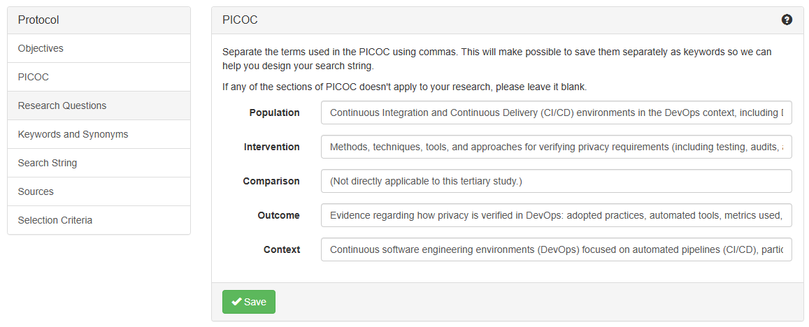
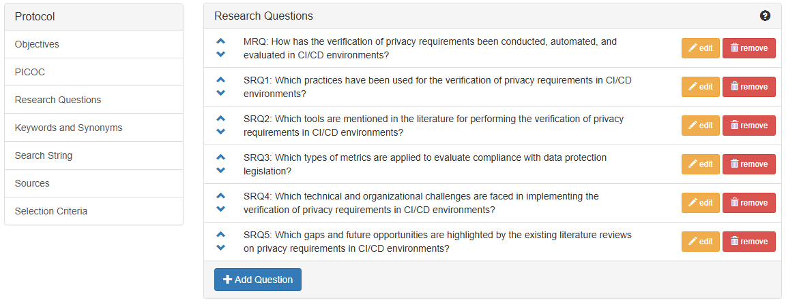
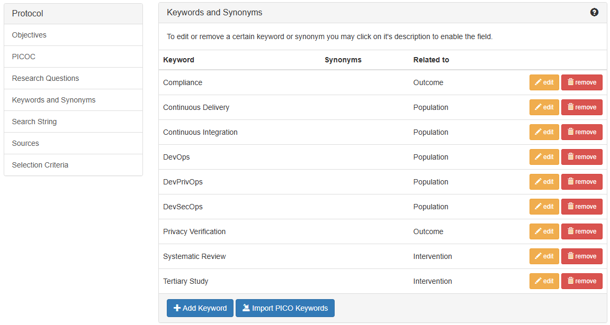
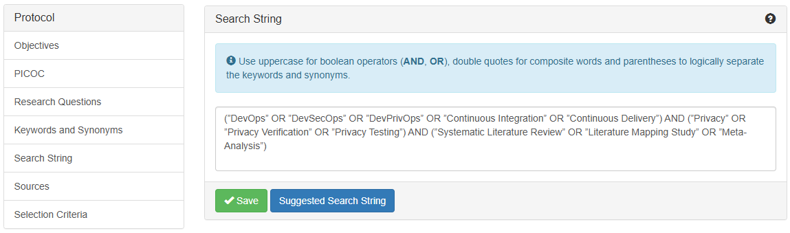
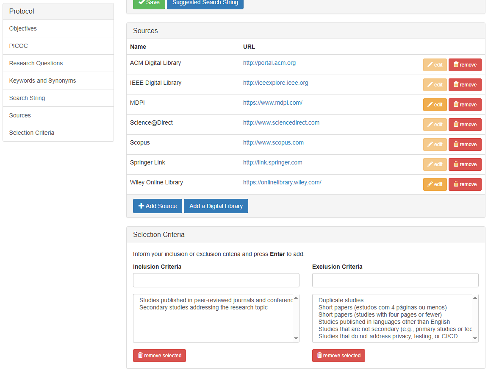
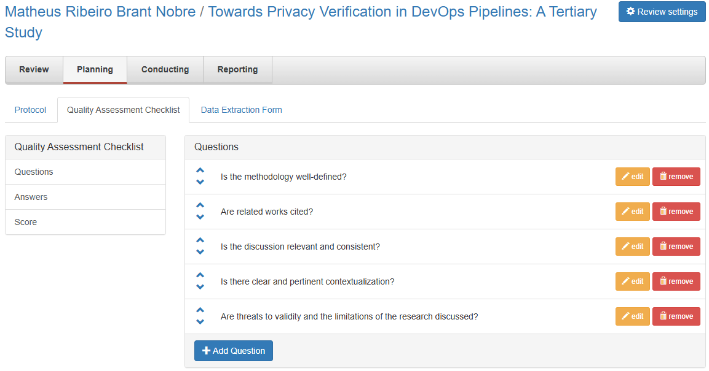
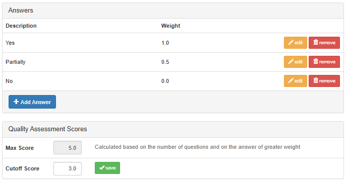
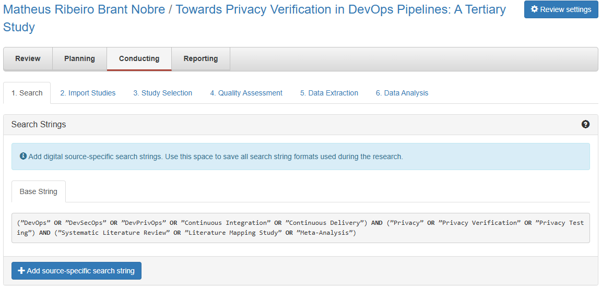

# Illustrated execution procedure

Screenshots depict documented project states; they do not necessarily record the chronological instant at which an action occurred.

## 1. Project creation and research overview

Inspect the corresponding screenshot and verify the configured values, source records and methodological decisions before reproducing this operation. See the stage protocol and the dissertation methodology for the exact research definitions.

## 2. Objectives and PICOC

Inspect the corresponding screenshot and verify the configured values, source records and methodological decisions before reproducing this operation. See the stage protocol and the dissertation methodology for the exact research definitions.

## 3. Research questions

Inspect the corresponding screenshot and verify the configured values, source records and methodological decisions before reproducing this operation. See the stage protocol and the dissertation methodology for the exact research definitions.

## 4. Keywords, synonyms and search string

Inspect the corresponding screenshot and verify the configured values, source records and methodological decisions before reproducing this operation. See the stage protocol and the dissertation methodology for the exact research definitions.

## 5. Database sources and selection criteria

Inspect the corresponding screenshot and verify the configured values, source records and methodological decisions before reproducing this operation. See the stage protocol and the dissertation methodology for the exact research definitions.

## 6. Quality assessment checklist and scoring

Inspect the corresponding screenshot and verify the configured values, source records and methodological decisions before reproducing this operation. See the stage protocol and the dissertation methodology for the exact research definitions.

## 7. Importing bibliographic records

Inspect the corresponding screenshot and verify the configured values, source records and methodological decisions before reproducing this operation. See the stage protocol and the dissertation methodology for the exact research definitions.

## 8. Screening and study selection

Inspect the corresponding screenshot and verify the configured values, source records and methodological decisions before reproducing this operation. See the stage protocol and the dissertation methodology for the exact research definitions.

## 9. Reviewer quality assessment

Inspect the corresponding screenshot and verify the configured values, source records and methodological decisions before reproducing this operation. See the stage protocol and the dissertation methodology for the exact research definitions.

## 10. Data extraction and synthesis

Inspect the corresponding screenshot and verify the configured values, source records and methodological decisions before reproducing this operation. See the stage protocol and the dissertation methodology for the exact research definitions.

