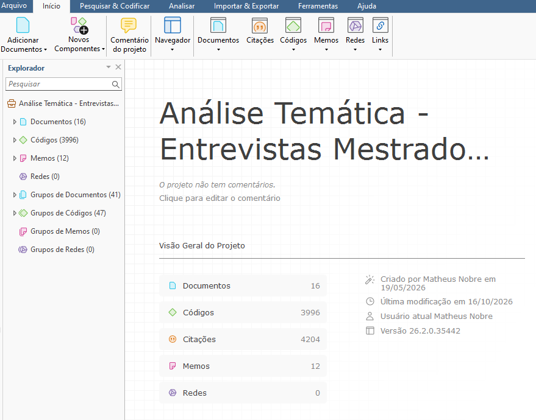
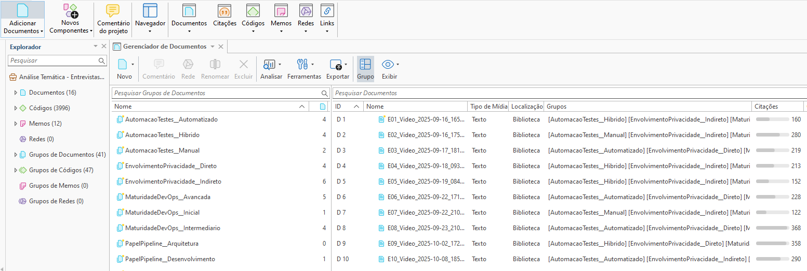
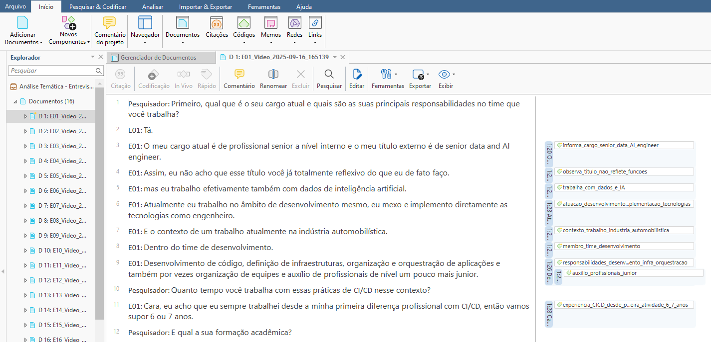
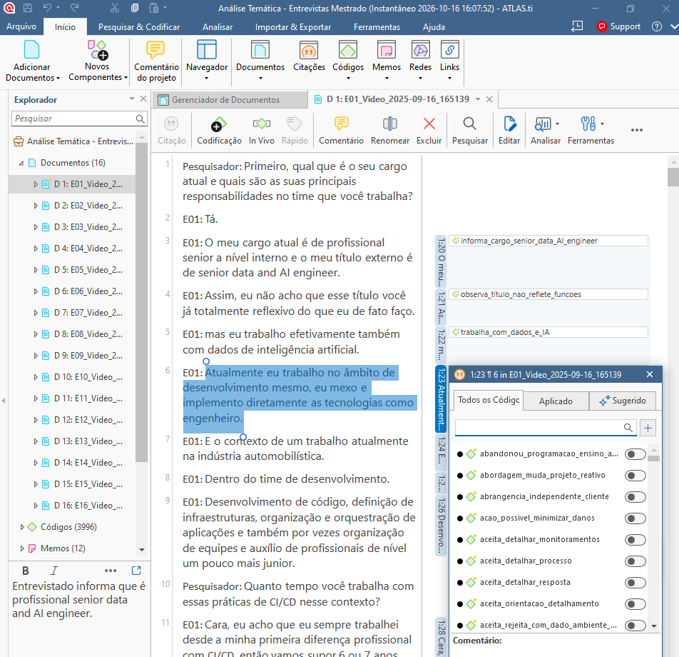
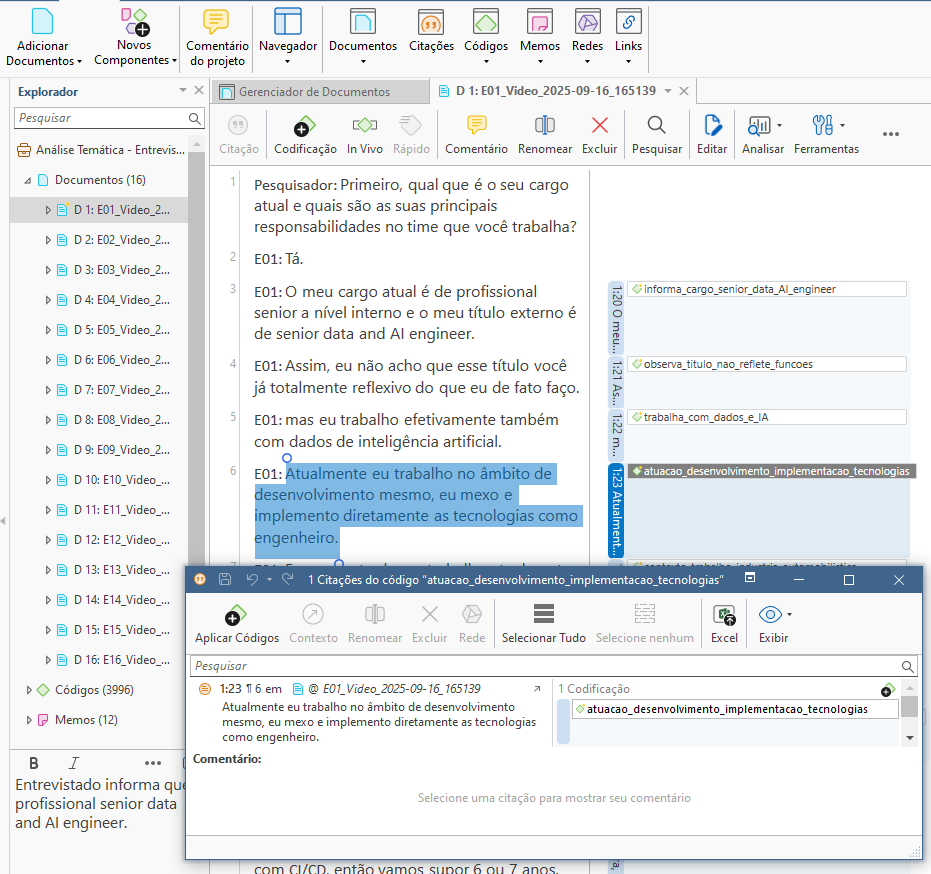
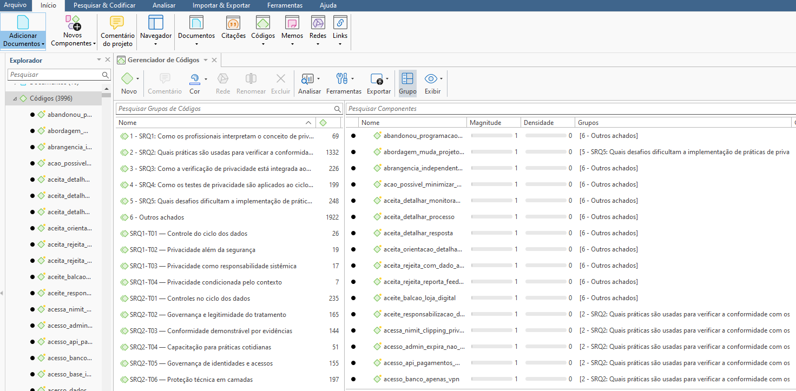
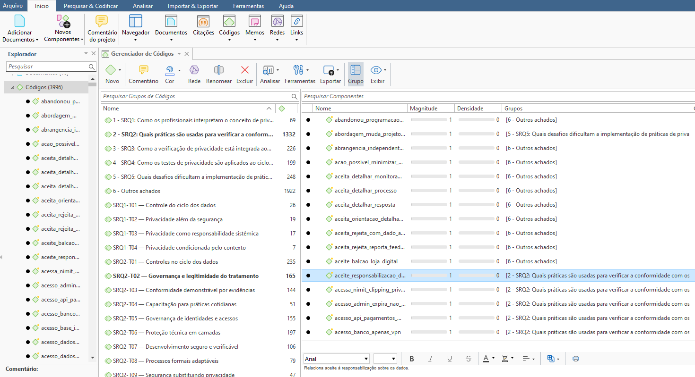
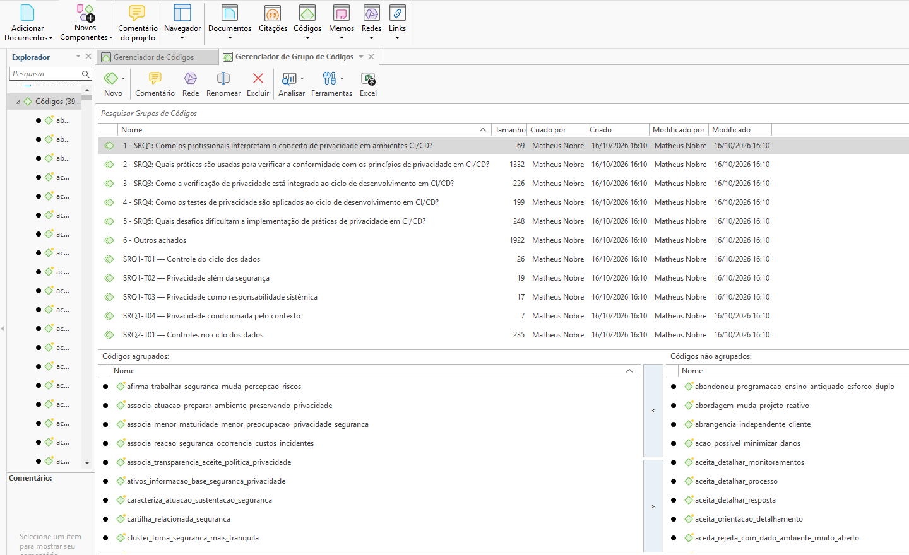
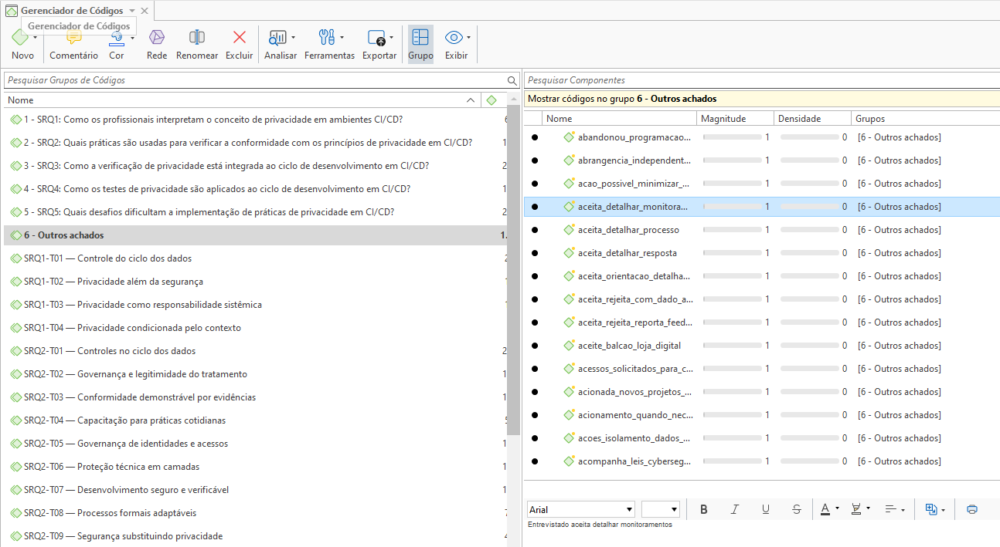
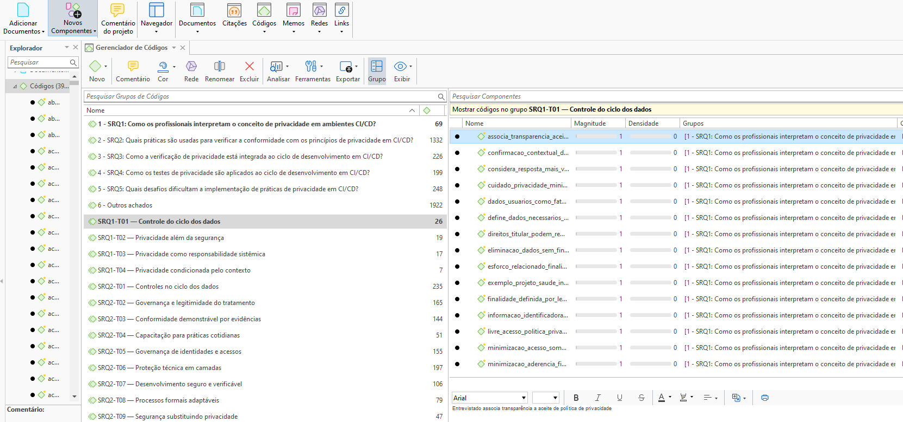

# Illustrated execution procedure

Screenshots depict documented project states; they do not necessarily record the chronological instant at which an action occurred.

## 1. Project overview and corpus

Inspect the corresponding screenshot and verify the configured values, source records and methodological decisions before reproducing this operation. See the stage protocol and the dissertation methodology for the exact research definitions.

## 2. Interview documents and contextual groups

Inspect the corresponding screenshot and verify the configured values, source records and methodological decisions before reproducing this operation. See the stage protocol and the dissertation methodology for the exact research definitions.

## 3. Transcript reading and familiarization

Inspect the corresponding screenshot and verify the configured values, source records and methodological decisions before reproducing this operation. See the stage protocol and the dissertation methodology for the exact research definitions.

## 4. Quotation selection and coding

Inspect the corresponding screenshot and verify the configured values, source records and methodological decisions before reproducing this operation. See the stage protocol and the dissertation methodology for the exact research definitions.

## 5. Checking coded quotations

Inspect the corresponding screenshot and verify the configured values, source records and methodological decisions before reproducing this operation. See the stage protocol and the dissertation methodology for the exact research definitions.

## 6. Code Manager and codebook

Inspect the corresponding screenshot and verify the configured values, source records and methodological decisions before reproducing this operation. See the stage protocol and the dissertation methodology for the exact research definitions.

## 7. Code comments and definitions

Inspect the corresponding screenshot and verify the configured values, source records and methodological decisions before reproducing this operation. See the stage protocol and the dissertation methodology for the exact research definitions.

## 8. Grouping by research question

Inspect the corresponding screenshot and verify the configured values, source records and methodological decisions before reproducing this operation. See the stage protocol and the dissertation methodology for the exact research definitions.

## 9. Preserving additional findings

Inspect the corresponding screenshot and verify the configured values, source records and methodological decisions before reproducing this operation. See the stage protocol and the dissertation methodology for the exact research definitions.

## 10. Consolidated thematic groups

Inspect the corresponding screenshot and verify the configured values, source records and methodological decisions before reproducing this operation. See the stage protocol and the dissertation methodology for the exact research definitions.

